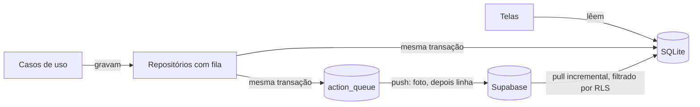

# Equinox Mobile ☀️

**Leitura de medidores de energia, com foto e GPS, que funciona sem internet.**

O Equinox Mobile é um aplicativo **offline-first e multiempresa** para técnicos
registrarem a leitura dos padrões de energia (consumo e, em usinas solares,
injeção) em endereços onde a internet falha. Tudo é gravado primeiro no
aparelho e sobe para a nuvem (**Supabase**) quando há conexão.

---

## Funcionalidades

- **Leitura com comprovante:** foto obrigatória do visor (1080p, ~300 KB) e GPS
  consultivo — fora do raio de 500 m vira aviso, nunca bloqueio.
- **Funciona offline:** registro, decisões e administração gravam no SQLite e
  entram numa fila de envio, na mesma transação.
- **Sincroniza sozinho:** ao abrir o app, quando a rede volta, logo após cada
  registro e por botão. Foto sobe antes da leitura; envio idempotente.
- **Login offline:** depois do primeiro login online, o app reabre autenticado
  em modo avião, com a sessão no `expo-secure-store`.
- **Multiempresa com segurança no banco:** Row Level Security por empresa e por
  nível; fotos num bucket privado, exibidas por URL assinada de 60 s.
- **Três perfis:** Técnico, Administrador e Super Admin.

## Stack

- **App:** React Native + Expo SDK 58 (Expo Router), TypeScript `strict`
- **Local:** SQLite (`expo-sqlite`), migrações por `PRAGMA user_version`
- **Nuvem:** Supabase — Auth, Postgres (RLS) e Storage — via `@supabase/supabase-js`
- **Rede:** `@react-native-community/netinfo`
- **Build:** EAS Build (APK de demonstração)
- **Testes:** Jest (4 projetos, `jest-expo`) + Testing Library; políticas de
  segurança testadas num Postgres embutido (PGlite)

Arquitetura: Clean Architecture + DDD + TDD. O domínio não importa nenhuma
biblioteca — há teste que reprova.

## Rodar

1. Instale as dependências:

   ```bash
   npm install
   ```

2. Configure o Supabase — **obrigatório**; sem isso o app abre numa tela que
   explica o que falta. Passo a passo em
   [docs/supabase-setup.md](docs/supabase-setup.md):

   ```bash
   cp .env.example .env.local
   ```

3. Suba o Expo e abra no Expo Go:

   ```bash
   npx expo start -c
   ```

Contas de demonstração: [docs/credenciais-demo.md](docs/credenciais-demo.md).

## Testar

```bash
npx tsc --noEmit
```

```bash
npm test
```

```bash
npm run test:coverage
```

```bash
npm run test:rls
```

Nenhum teste fala com a nuvem. O último roda as políticas de RLS e Storage
contra um Postgres de verdade embutido.

## Sincronização em uma figura



## Documentação

- [Respostas para a banca (12 pontos da apresentação)](docs/presentation/respostas-da-banca.md)
- [Decisões de arquitetura (ADR)](docs/decisions.md) — a seção 10 cobre a nuvem
- [Configurar o Supabase](docs/supabase-setup.md) · [Gerar o APK](docs/eas-build.md)
- [Regras para agentes e contribuidores](AGENTS.md)
- [Roteiro de testes manuais](docs/roteiro-de-testes.md) · [Testar no Android](docs/testar-no-android.md)
- [Especificação de software](docs/documento-software.md) · [Diagramas](docs/diagrams/)
- Schema remoto: [supabase/migrations/](supabase/migrations/) · local: [src/infrastructure/database/sqlite/migrations/](src/infrastructure/database/sqlite/migrations/)
