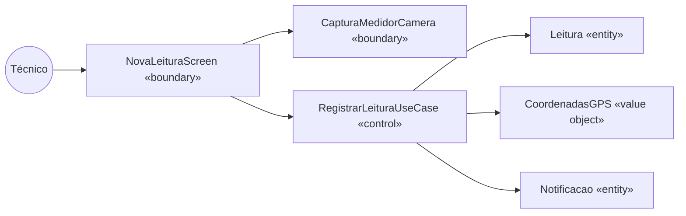
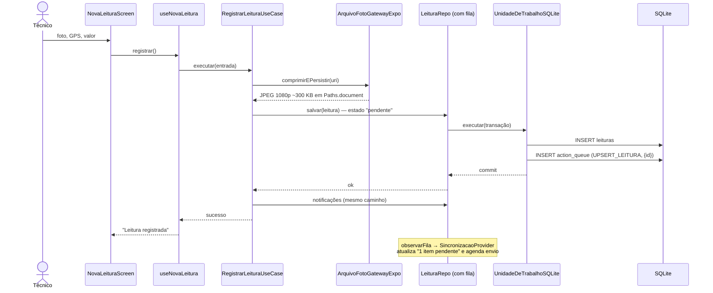
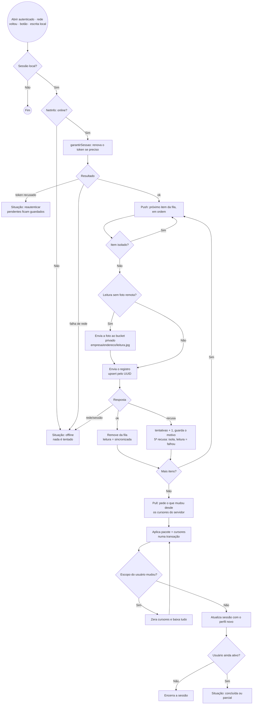
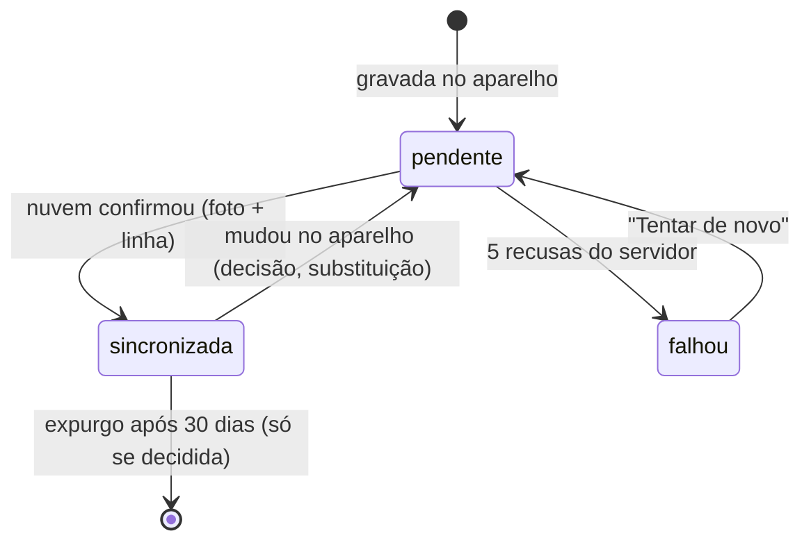
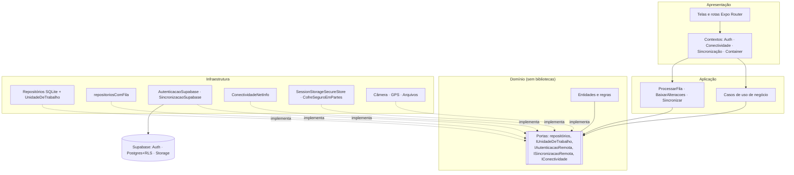

# Diagramas Dinâmicos e Arquiteturais — Equinox Mobile

Correspondem ao código da fase 7 (offline-first com Supabase, ADR seção 10).

## 1. Mapeamento BCE (Boundary-Control-Entity)

## 2. Sequência — leitura registrada offline

A escrita da leitura e o item da fila de envio vão na **mesma transação**. O
caso de uso não sabe da fila: recebe um repositório que salva e enfileira
(`repositoriosComFila`).

## 3. Atividades — uma rodada de sincronização

## 4. Estados de sincronização de uma leitura

## 5. Componentes (Clean Architecture)

